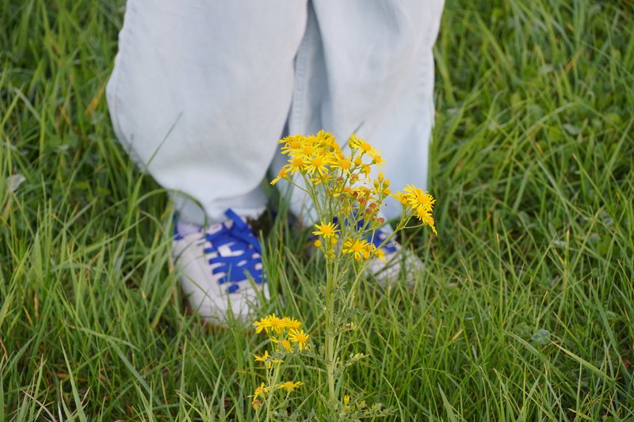
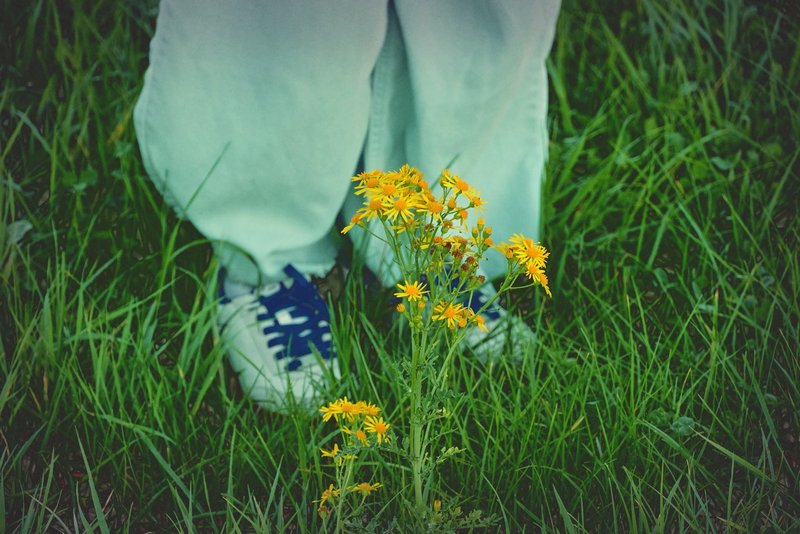
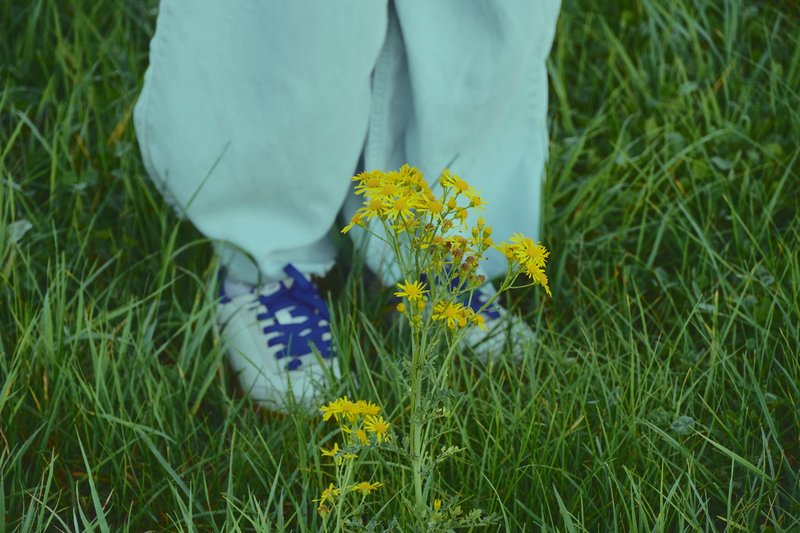

# PresetFit

Give one photo the look of another. You get back the edited photo, the slider
values that made it, and a `.cube` LUT for carrying the look into other editors.

You supply two pictures: **your photo** and a **reference** whose look you like.
The picture is produced *by* the reported sliders, so the list always describes
exactly what was done.

## Example

| Your photo | Reference | Result |
|---|---|---|
|  |  |  |

The reference is an edited copy of the same photo. This is the report from that
run, unchanged:

```
EDITS APPLIED
--------------------------------------------------------
White balance
  Temperature  -50 (cooler)
  Tint         -50 (more green)
Exposure
  Exposure     -0.54 EV
Contrast
  Contrast     +38
Highlights & shadows
  Highlights   +9
  Shadows      -5
Tone curve
  Point 0      0 → 30
  Point 64     64 → 61
  Point 128    128 → 131
  Point 191    191 → 191
  Point 255    255 → 255
Saturation
  Saturation   -21
HSL (per colour)
  Yellows      hue -30, saturation +24, luminance -8
  Greens       hue +27, saturation -12, luminance +7
  Aquas        hue +3, saturation +23, luminance -5
Split toning
  Shadows      yellow tint, hue 112°, strength 2.7
  Highlights   green tint, hue 163°, strength 15.7
--------------------------------------------------------
Look distance to reference: 8.34 -> 1.80 (78% of the gap closed)

Note: Per-colour (HSL) edits were skipped for red, orange, blue, purple and magenta: the two photos do not share enough of those colours.
```

What it got and what it missed:

- **Carried over:** the cool, green-teal colour of the grade.
- **Missed:** the reference is darker, with deeper shadows and darkened corners.
  The result is lighter and flatter. Darkened corners are a vignette, a local
  edit that PresetFit does not make.
- **Hit a limit:** temperature and tint both stopped at -50, the furthest the
  fitter is allowed to move white balance (see [What to expect](#what-to-expect)).

Measured with version 0.1.0 on 10 October 2026: a 24-megapixel photo took about
33 seconds on a Windows PC.

## Quick start

Requires Python 3.10 or newer.

```bash
git clone https://github.com/tanmoy79/presetfit.git
cd presetfit
python -m venv .venv
source .venv/bin/activate          # Windows PowerShell: .venv\Scripts\Activate.ps1
pip install ".[api]"
```

To work on the code instead, install it in editable mode with the development
tools: `pip install -e ".[dev]"`.

### In the browser

```bash
presetfit serve
```

Open <http://127.0.0.1:8000>, drop in your two photos and choose **Match look**.
Each photo is checked the moment you add it, and a file that cannot be used is
flagged under that photo. From the result you can compare with the original and
download the photo, a reusable preset, or a `.cube` LUT.

**Photo formats:** JPEG (including the MPO files many cameras save as `.JPG`),
PNG, WebP, TIFF and BMP. Camera RAW and HEIC are not supported yet.

### On the command line

```bash
# Match, and also save the look for later
presetfit match my_photo.jpg reference.jpg -o result.jpg --preset look.json --lut look.cube

# Apply the same look to another photo
presetfit apply another_photo.jpg --preset look.json -o another_result.jpg

# Apply the look at 70% strength
presetfit match my_photo.jpg reference.jpg --strength 0.7
```

### From Python

```python
from presetfit import ImageReader, ImageWriter, PresetFitService, TextReportFormatter

service = PresetFitService.create_default()
reader = ImageReader()
result = service.match(reader.read("my_photo.jpg"), reader.read("reference.jpg"))

ImageWriter().write(result.image, "result.jpg")
print(TextReportFormatter().format(result.report))
print(result.settings.to_dict())  # the raw slider values
```

## How it works

A single edited picture does not contain its own editing history, because the
unedited original is unknown. So PresetFit does not "read the edits off" the
reference. It **measures** the reference's look and then **searches** for the
slider values that give your photo the same measurements.

1. **Sample.** Take 8,000 random pixels from each photo. Every edit acts on each
   pixel independently, so a sample behaves like the whole image.
2. **Measure.** Convert to the Lab colour space and summarise each sample as a
   few dozen numbers (`LookStatistics`): the lightness distribution, the average
   colour cast, how colourful it is, the cast in shadows versus highlights, and
   the average colour inside eight colour bands.
3. **Fit.** For one family of sliders at a time, try values, re-measure, and let
   a least-squares solver move the sliders until the measurements match.
4. **Render.** Apply the final, rounded slider values to the full-size photo.

| Edit | Sliders | Fitted against |
|---|---|---|
| Exposure | stops, -3 to +3 | lightness distribution |
| Contrast | -100 to +100 | lightness distribution |
| Highlights & shadows | two, -100 to +100 | lightness distribution |
| Saturation | -100 to +100 | spread of colours around the average |
| White balance | temperature, tint | average colour cast |
| Tone curve | five control points | what the sliders above left unexplained |
| Split toning | shadow tint, highlight tint | cast in shadows vs highlights |
| HSL | hue, saturation, luminance for 8 colours | average colour inside each band |

The stages run broadest-first, so simple sliders explain as much as they can
before flexible ones (tone curve, HSL) get a turn. That keeps the report
readable.

## What to expect

**Measured results** (version 0.1.0, 10 October 2026, 24-megapixel photos):

| Case | Gap closed |
|---|---|
| Reference is an edited copy of the same photo (the example above) | 78% |
| Reference is a different photo of a similar outdoor scene | 51% |

"Gap closed" is how much the look distance shrank: the difference between the
two photos' measurements (lightness distribution, colour cast, colourfulness,
shadow and highlight casts), before and after. 100% would mean the measurements
match exactly. It measures statistics, not how alike the photos look to the eye,
so check the result yourself. These figures come from two photo pairs and will
be updated as the project changes.

**Know the limits:**

- **Subject and look are entangled.** A photo of a sunset is orange because of
  the sunset, not only because of the edit. Matching a forest to it will warm
  the forest. The more the two photos differ in subject and lighting, the more
  of the "look gap" is really a subject gap. The fitter limits how far each
  slider may travel so that such cases stay plausible (white balance, for
  example, may use only -50 to +50 of its -100 to +100 range), and the report
  tells you how much of the gap it closed. The cost is that a strong grade can
  hit these limits, as in the example above.
- **Several slider combinations can give the same picture.** Lifted blacks can
  be described as lower contrast or as a raised tone-curve point. The fit
  returns one valid description, preferring the simplest sliders.
- **Per-colour edits need shared colours.** If the reference has no blue, the
  blue sliders are left alone, and the report says so.
- **The numbers are PresetFit's own scale.** Lightroom's formulas are not
  public, so `+12 contrast` here is not `+12` there. To carry a look into
  Lightroom, Photoshop or a video editor, export the `.cube` LUT.
- **Global edits only.** Local adjustments, sharpening, grain and vignettes are
  out of scope.
- **sRGB is assumed.** Embedded colour profiles are not converted.

## Project layout

```
src/presetfit/
├── color/            colour science
│   ├── spaces.py       sRGB <-> linear <-> Lab conversions
│   ├── pixels.py       Pixels: an array that knows its colour space
│   └── masks.py        soft selections (colour bands, shadows/highlights)
├── edits/            the eight adjustments
│   ├── base.py         Edit (abstract base class), ParamSpec
│   ├── tone.py         Exposure, Contrast, HighlightsShadows, ToneCurve
│   ├── color.py        WhiteBalance, Saturation, HueSaturationLuminance, SplitToning
│   ├── settings.py     EditSettings: immutable slider values
│   └── pipeline.py     EditPipeline: runs edits in order
├── analysis/         measuring a look
│   ├── sampling.py     PixelSampler
│   └── statistics.py   LookAnalyzer -> LookStatistics
├── fitting/          finding the slider values
│   ├── base.py         LookFitter (interface), FitResult
│   ├── objectives.py   what each stage tries to match
│   └── staged.py       StagedLookFitter
├── rendering.py      Renderer: full-size output in memory-bounded strips
├── imaging.py        ImageReader, ImageWriter
├── report.py         LookReport and text formatting
├── export.py         PresetCodec (JSON), CubeLutExporter (.cube)
├── service.py        PresetFitService: the one entry point
├── cli.py            command line
└── api/              web app (FastAPI) and the single-page interface
tests/                313 tests, 99% coverage
```

Dependencies point one way: `cli` and `api` → `service` → `fitting`, `rendering`,
`report`, `export` → `edits`, `analysis` → `color`. Nothing lower knows about
anything higher.

### Suggested reading order

To learn the codebase, read it bottom-up, running the matching tests as you go:

1. `color/spaces.py`, `color/pixels.py` — what the numbers in an image mean
2. `edits/base.py`, then `edits/tone.py` and `edits/color.py` — one edit at a time
3. `edits/pipeline.py` — chaining edits
4. `analysis/statistics.py` — turning a look into numbers
5. `fitting/objectives.py`, `fitting/staged.py` — the search
6. `service.py`, then `cli.py` and `api/app.py` — how it is put to use

### Design choices worth noticing

| Idea | Where | Why |
|---|---|---|
| Abstract base class + polymorphism | `Edit`, `Objective`, `LookFitter` | The pipeline, fitter, report and LUT exporter work with *any* edit. A new adjustment is one new class and nothing else changes. |
| Strategy pattern | `LookFitter`, `Objective` | The algorithm can be swapped (for example for a neural network) without touching callers. |
| Facade | `PresetFitService` | The CLI and web app share one entry point and cannot drift apart. |
| Dependency injection | `PresetFitService.__init__`, `create_app` | Tests pass in fakes; nothing is created at import time. |
| Immutable value objects | `EditSettings`, `Pixels`, `FitResult` | Safe to share between threads; no half-updated state. |
| Types that carry meaning | `Pixels` | A Lab operation can never be applied to sRGB data by accident. |
| One exception hierarchy | `exceptions.py` | Each layer catches `PresetFitError` and reports it its own way. |
| Single source of truth | `color/masks.py` | An edit and the statistic that measures it use the same selection. |

## Web API

Interactive documentation is served at `/docs` while the app runs.

| Method | Path | Purpose |
|---|---|---|
| `POST` | `/api/v1/inspect` | Form upload of one `photo`. Checks it and returns its size and a small preview. |
| `POST` | `/api/v1/match` | Form upload of `source`, `reference` and optional `strength`. Returns the picture, settings and report. |
| `POST` | `/api/v1/apply` | Form upload of `source` and a `preset` document. Returns the picture. |
| `POST` | `/api/v1/preset` | Settings in, preset file out. |
| `POST` | `/api/v1/lut` | Settings in, `.cube` file out. |
| `GET` | `/api/v1/edits` | The edits and their slider ranges. |
| `GET` | `/health` | Liveness check. |

Errors always have the shape `{"error": "<code>", "detail": "<message>"}`.

### Configuration

| Environment variable | Default | Meaning |
|---|---|---|
| `PRESETFIT_MAX_UPLOAD_MB` | 25 | Largest accepted file |
| `PRESETFIT_MAX_MEGAPIXELS` | 40 | Largest accepted image |
| `PRESETFIT_JPEG_QUALITY` | 92 | Quality of returned pictures |
| `PRESETFIT_LOG_LEVEL` | INFO | Logging threshold |

## Development

The four checks CI runs, from the project root with the virtual environment
active:

```bash
ruff check .            # lint: likely mistakes and style problems
ruff format --check .   # code layout (run "ruff format ." to fix it)
python -m mypy          # strict type check
pytest --cov            # tests, with a coverage report
```

Where `make` is available, `make check` runs the same commands.

- **Style and linting:** Ruff
- **Types:** mypy in strict mode
- **Tests:** pytest; warnings in project code fail the build; coverage must stay above 90%
- **CI:** GitHub Actions runs all of the above on Python 3.10 to 3.13

## Deployment

```bash
docker build -t presetfit .
docker run --rm -p 8000:8000 presetfit
```

The image runs as a non-root user and has a health check. Before exposing it to
the internet:

- Put it behind a reverse proxy that terminates HTTPS and enforces its own
  request-size limit.
- Add authentication or rate limiting. A match is CPU-heavy (about 2 seconds
  for the fit, plus roughly 1 second per megapixel to render), so an open
  endpoint is easy to overload.
- Run several workers (`uvicorn ... --workers 4`) and allow about 1 GB of memory
  per worker for 24-megapixel photos.

Uploaded photos are processed in memory and never written to disk. Returned
pictures carry no metadata from the original.

## Licence

MIT. See `LICENSE`.
